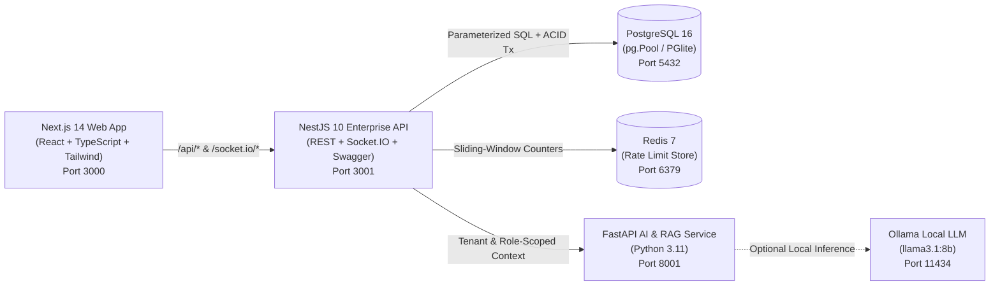

# OpsPilot — AI-Powered Enterprise Operations Intelligence Platform

**OpsPilot** is a multi-tenant enterprise operations management platform engineered for manufacturing, industrial maintenance, and engineering organizations. It unifies **Authentication & RBAC, Multi-Tenant HR, MRO Inventory & Automated Procurement, Preventive & Corrective Maintenance, Approval Workflows, Real-Time + Email Notifications, Security Audit Governance, Executive Analytics, and a Permission-Aware AI Business & RAG Assistant** in one cohesive monorepo.


---

## Core Enterprise Capabilities

| Module | What Is Implemented |
| :--- | :--- |
| **Authentication & Sessions** | Tenant onboarding, bcrypt (cost 12) password hashing, 15m JWT access tokens, single-use SHA-256-hashed 7d refresh token rotation, session revocation |
| **Multi-Tenancy & RBAC** | Strict `company_id` isolation across all 15 PostgreSQL tables; 5 role tiers (`SUPER_ADMIN`, `COMPANY_ADMIN`, `MANAGER`, `EMPLOYEE`, `VIEWER`) enforced via guards |
| **HR & Organization** | Employee directory, departmental structure, headcount metrics, role & status management (`VIEWER` blocked from personal HR roster) |
| **MRO Inventory & Suppliers** | SKU catalog, stock ledger (`IN`/`OUT`/`ADJUSTMENT`), vendor lead times, **automated low-stock replenishment workflow** |
| **Maintenance & Assets** | Industrial asset registry, lifecycle maintenance spend per machine, scheduled preventive intervals (`+ Schedule PM`), corrective/preventive work orders |
| **Workflow & Approvals** | Automated & manual Purchase Orders (`PO-*`), manager/admin approval queue, 1-click **Goods Receipt** that atomically replenishes inventory |
| **Notifications** | Live Socket.IO WebSocket push (`user:<id>` rooms) + transactional email dispatcher (`SMTP_WEBHOOK_URL` + inspectable email outbox) |
| **Executive Analytics** | Single-pass PostgreSQL aggregations: inventory valuation, low-stock count, maintenance spend by asset, work-order status/priority charts |
| **AI Assistant & SOP RAG** | Permission-aware natural-language business queries + indexed company SOP/policy retrieval with factual **Evidence** and **Document Citations** (FastAPI + Ollama `llama3.1:8b` with deterministic offline fallback) |
| **Security & Audit** | Redis/in-memory sliding-window rate limiter (`X-RateLimit-*`), Helmet, strict DTO validation, immutable `audit_logs` with secret redaction |

---

## System Architecture



---

## Quick Start (Option 1: Docker Compose — Full Production Stack)

```bash
git clone https://github.com/vidu1999/enterprise-AI-platforme.git
cd enterprise-AI-platforme
docker compose up --build
```

- **Web App**: `http://localhost:3000`
- **REST API**: `http://localhost:3001/api`
- **Swagger / OpenAPI Docs**: `http://localhost:3001/docs`
- **FastAPI AI Service**: `http://localhost:8001/health`

## Quick Start (Option 2: Zero-Docker Local Development)

When an external PostgreSQL daemon is not running on `localhost:5432`, `DatabaseService` automatically boots an embedded **PostgreSQL 16** engine (`@electric-sql/pglite` at `apps/api/.pglite-data`), runs `sql/001_init.sql`, and seeds the enterprise demo dataset:

```bash
# 1. Install workspace dependencies
npm install

# 2. Start the Python AI service (Terminal 1)
cd services/ai && python3 -m venv .venv && .venv/bin/pip install -r requirements.txt
.venv/bin/uvicorn app.main:app --host 0.0.0.0 --port 8001

# 3. Build & start the NestJS API (Terminal 2)
npm run build --workspace=apps/api
npm run start:prod --workspace=apps/api

# 4. Start the Next.js Web UI (Terminal 3)
npm run dev --workspace=apps/web
```

---

## Pre-Seeded Demo Accounts (Password: `Demo1234!`)

| Persona | Email | Role | What to Test |
| :--- | :--- | :--- | :--- |
| **VP of Operations** | `admin@demo.local` | `COMPANY_ADMIN` | Full access across Lanka Precision Engineering PLC |
| **Maintenance Manager** | `manager@demo.local` | `MANAGER` | Approve POs, manage inventory, schedule PMs, index SOPs |
| **Senior Technician** | `tech@demo.local` | `EMPLOYEE` | Execute work orders, issue MRO stock (`−1 Out`) |
| **Compliance Auditor** | `viewer@demo.local` | `VIEWER` | Read-only KPIs; blocked (`403`) from HR roster & mutations |
| **Tenant #2 Director** | `admin@colombologistics.local` | `COMPANY_ADMIN` | Separate company (`Colombo Port Logistics`) proving zero cross-tenant leakage |

---

## Automated Testing

```bash
# NestJS Unit Tests (Auth, RBAC, Low-Stock Automation)
npm test --workspace=apps/api

# Full-Stack API Integration / E2E Suite against PostgreSQL 16
npm run test:e2e --workspace=apps/api

# Python FastAPI AI & RAG Test Suite
cd services/ai && pytest -q

# Playwright Browser E2E Suite
cd apps/web && npx playwright test
```

---

## Documentation

- [System Architecture](docs/ARCHITECTURE.md)
- [Database Schema & Mermaid ER Diagram](docs/DATABASE.md)
- [REST & WebSocket API Reference](docs/API.md)
- [Enterprise Security Controls](docs/SECURITY.md)
- [5-Minute Engineering Walkthrough Script](docs/DEMO.md)
- [Post-MVP Engineering Roadmap](docs/ROADMAP.md)
- [Supabase PostgreSQL Deployment Guide](supabase/README.md)

---

## Monorepo Structure

```text
enterprise-AI-platforme/
├── apps/
│   ├── api/                 # NestJS 10 modular backend + PostgreSQL 16 migrations & E2E tests
│   └── web/                 # Next.js 14 App Router + TypeScript + Tailwind + Recharts + Playwright
├── services/
│   └── ai/                  # Python FastAPI permission-aware business assistant & SOP RAG engine
├── supabase/                # Supabase PostgreSQL schema migration & cloud deployment guide
├── docs/                    # Architecture, ER diagram, API reference, security & demo guide
├── .github/workflows/ci.yml # GitHub Actions CI (Postgres 16 + Redis 7 + API + Web + AI)
└── docker-compose.yml       # One-command multi-container orchestration
```
