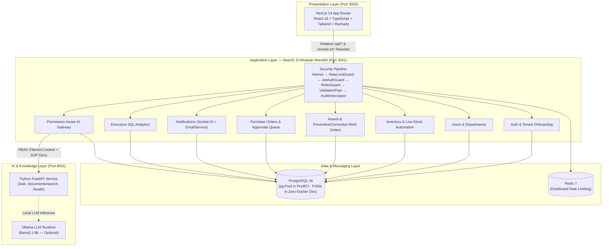

# OpsPilot — System Architecture

## High-Level Topology

## Key Architectural Decisions

1. **Modular Monolith Backend + Dedicated Python AI Service**:
   - Core transactional operations (`inventory_items`, `purchase_orders`, `approvals`, `work_orders`) run inside a single NestJS service so multi-step workflows execute inside **ACID PostgreSQL transactions** (`BEGIN ... COMMIT`).
   - Natural-language reasoning and document scoring live in an isolated Python FastAPI microservice (`services/ai`) so Python ML/LLM dependencies scale independently and never block core API latency.
2. **Dual-Driver PostgreSQL 16 Engine (`DatabaseService`)**:
   - Uses `pg.Pool` whenever `DATABASE_URL` connects to an external PostgreSQL 16 instance (Docker Compose, GitHub Actions CI, Supabase, AWS RDS).
   - Automatically falls back to `@electric-sql/pglite` (real PostgreSQL 16 compiled to WASM) in local environments without Docker and in isolated E2E test runs, executing the exact same `sql/001_init.sql` schema.
3. **Defense-in-Depth Permission-Aware AI**:
   - The LLM never receives raw database credentials or SQL access.
   - NestJS `AiService` queries strictly `WHERE company_id = $1` and filters sensitive HR counts and higher-privilege SOP documents (`min_role`) *before* sending context to FastAPI, which enforces a second role check.
4. **Zero-Localhost Browser Networking**:
   - All browser requests target relative `/api/*`, `/docs`, and `/socket.io/*` paths, proxied server-side by Next.js `rewrites()` to `INTERNAL_API_URL`, guaranteeing identical behavior across localhost, Docker networks, reverse proxies, and cloud preview URLs.
