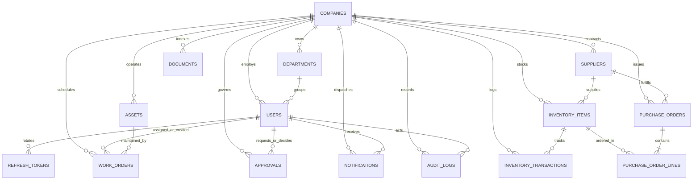

# OpsPilot — Database Schema & Entity-Relationship Diagram

Source DDL: [`apps/api/sql/001_init.sql`](../apps/api/sql/001_init.sql) (mirrored in [`supabase/migrations/20260101000000_opspilot_init.sql`](../supabase/migrations/20260101000000_opspilot_init.sql)).

## Entity-Relationship Diagram (Mermaid)

## Multi-Tenancy & Indexing Strategy

- Every tenant-owned table includes `company_id UUID NOT NULL REFERENCES companies(id) ON DELETE CASCADE`.
- Composite uniqueness constraints enforce tenant-scoped natural keys:
  - `users (company_id, email)`
  - `departments (company_id, name)`
  - `suppliers (company_id, name)`
  - `inventory_items (company_id, sku)`
  - `assets (company_id, code)`
  - `purchase_orders (company_id, number)`
- Targeted B-tree indexes accelerate hot operational queries:
  - `idx_work_orders_company_status (company_id, status)`
  - `idx_approvals_company_status (company_id, status)`
  - `idx_notifications_user_read (company_id, user_id, read)`
  - `idx_audit_logs_company_created (company_id, created_at DESC)`
